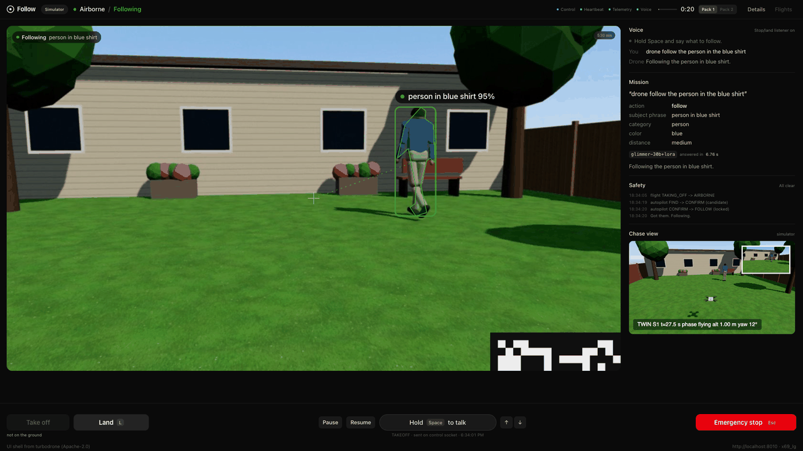
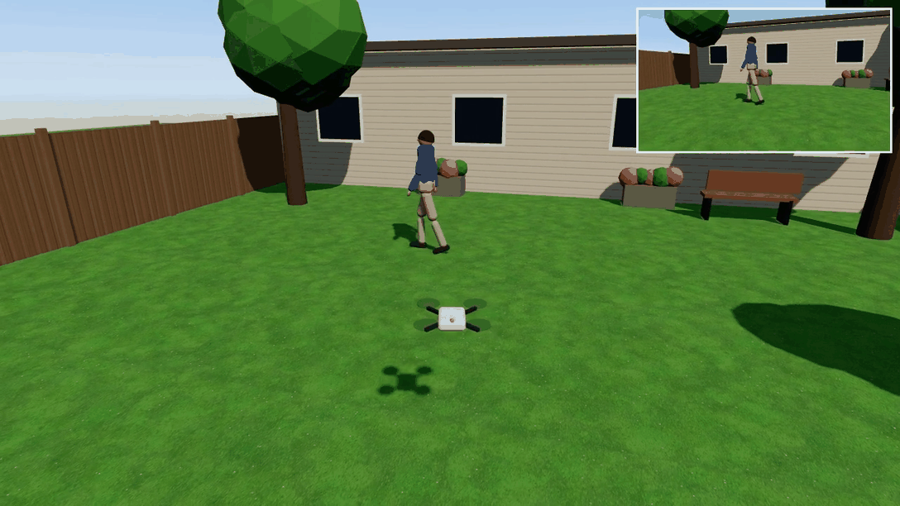
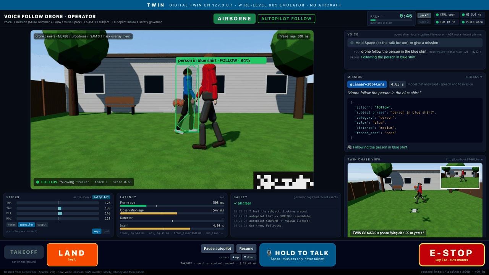
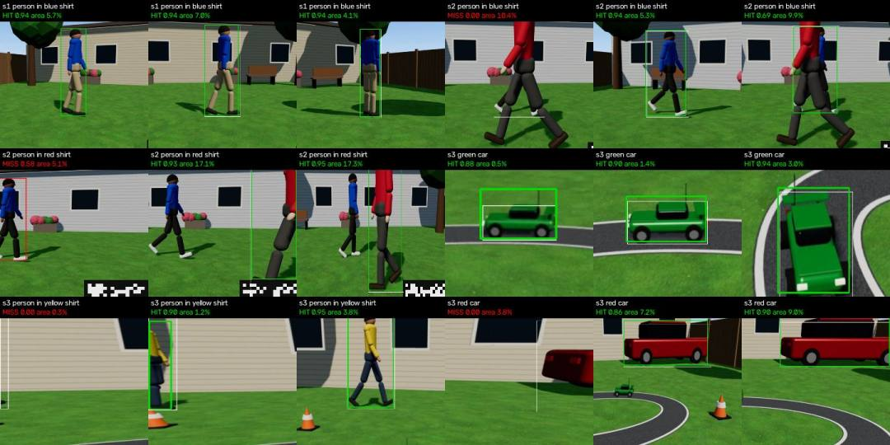
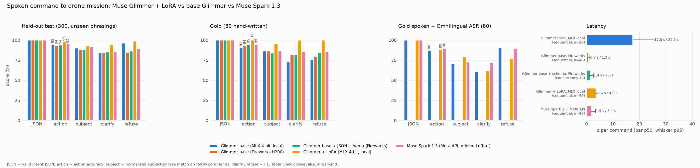

# Voice Follow Drone

**A $34 toy drone that follows a person or a car you describe by voice, built on Meta models.**



*The operator UI flying the digital twin. The command (voiced by macOS `say` into the agent's
microphone input) went through Muse Voice Transcribe and our fine-tuned Muse Glimmer (badge
`glimmer-30b+lora`); SAM 3.1 masks the subject, and the autopilot is in FOLLOW.*

Hold Space and say "follow the person in the blue shirt". Muse Voice Transcribe turns your words
into text, our fine-tuned Muse Glimmer turns the text into a mission, SAM 3.1 finds that person in
the drone's video, and a classical controller inside a safety governor turns a Loiley X69 to keep
them in frame. Say "land" at any time: a Meta speech model running on the laptop hears it, even
with no internet.

It is a consumer follow-me camera: a hands-free, voice-directed camera operator for creators,
coaches, and people with limited mobility. It picks the subject by appearance only ("the person in
the blue shirt", "the green car"), never by identity. Ask it to "follow John" and it answers "I
can't follow someone by identity. Tell me what they're wearing instead." It films only people who
agreed to be filmed, and it calls the person or thing it follows the *subject*.

> **Status, 2026-11-04 03:40 ET.** The whole chain runs end to end in a wire-level digital twin on
> one Mac: a spoken command, Muse Voice Transcribe, our fine-tuned Glimmer, SAM 3.1, the autopilot
> and the safety governor, real X69 control packets out and HEVC video back (pictured above). The
> real drone flies this morning, after a props-off hardware check (Session A). This line will be
> updated with the result.

**Demo video (3 min):** _link coming: VIDEO_LINK_

| The twin's chase view: the drone (center) turns to keep the walker in blue in frame | S2: a walker in red crosses between the drone and the subject in blue |
|---|---|
|  |  |

## How it works

1. **You speak.** Push-to-talk audio streams to Muse Voice Transcribe. The final transcript arrives
   about 0.23 s after you stop talking.
2. **A model picks the mission; it never flies.** Our LoRA-tuned Muse Glimmer 30B and Muse Spark 1.3
   race to turn the transcript into a mission that must validate against a fixed JSON schema:
   `{"action":"follow","subject_phrase":"person in blue shirt","category":"person","color":"blue",...}`.
   Clarify and refuse answers are spoken and change nothing in flight.
3. **SAM 3.1 finds the subject** in the newest frame from the words alone, 1-2 times a second.
   OpenCV's VitTrack follows the box at camera rate, and a Kalman filter keyed on capture time
   smooths it.
4. **A deterministic autopilot steers.** Every 40 ms RC tick, a pure function turns the box into yaw
   and forward sticks. It runs inside the safety governor, which owns every packet: latched E-stop,
   re-asserted land, watchdogs, caps, and human override.
5. **The same packets fly the drone or the twin.** turbodrone's X69 driver (its files unchanged; our
   subclasses add capture timing and keepalive retries) sends real 28-byte UDP packets at 25 Hz and
   reads HEVC video over RTSP, from the X69 or from the twin.
6. **"Stop" and "land" never wait for the cloud.** An always-on listener (Omnilingual ASR on the
   laptop) sends them straight to the governor.

```
 you: hold Space, "follow the person in the blue shirt"       you: "land" (works offline)
   |                                                            |
 agent (CPU)                                                  safety listener: silero VAD +
   Muse Voice Transcribe (Meta API) -> transcript             Omnilingual ASR CTC-300M -> land / pause
   Glimmer 30B + LoRA (Mac) | Muse Spark 1.3 (Meta API)         |
     race -> JSON mission (schema-checked); MMS-TTS replies     |
   | POST /mission                                              | POST /command
   v                                                            v
 drone backend: patched turbodrone FastAPI, :8000  <----  operator UI: patched turbodrone React, :5173
   hub --FindRequest-->  perception: newest frame -> SAM 3.1 (MLX on the Mac, or Meta API)
   <------SubjectObs---    -> VitTrack at camera rate -> Kalman filter on capture time
   safety governor, every 40 ms RC tick (the only path to the sticks):
     E-stop latch > land > human sticks > autopilot; staleness watchdogs; caps; wrong-way checks
     autopilot(SubjectObs) -> yaw, pitch    FIND -> CONFIRM -> FOLLOW -> DOUBT -> LOST -> SEARCH
   X69 RC adapter (turbodrone, unchanged) -> 28-byte UDP packets, 25 Hz
   |                                                 ^ HEVC 1280x720 over RTSP
   v                                                 |
 real: Loiley X69 at 172.16.11.1        twin: 127.0.0.1, same packets and video. X69 dynamics, Three.js
                                        world in Chrome, ffmpeg hevc_videotoolbox -> mediamtx, ground truth
```

| Process | What it does | Ports | Start |
|---|---|---|---|
| drone backend | patched turbodrone FastAPI: RC link, video in, safety governor with the autopilot, mission API, hub | 8000 | `scripts/run_backend.sh --mode twin` or `--mode real` |
| perception | newest frame to SAM 3.1, VitTrack and a Kalman filter; one `SubjectObs` per frame | client of 8000 | `$MHD_ML_PY -m mhd_ml.perception.service` |
| agent | safety listener, push-to-talk, Voice Transcribe, Glimmer/Spark router, MMS-TTS replies | client of 8000 | `$MHD_ML_PY -m mhd_ml.agent.service` |
| twin | X69 emulator: RC decoder, 100 Hz dynamics, Three.js renderer, HEVC/RTSP through mediamtx, ground truth | UDP 23458, HTTP/WS 8766, RTSP 8554 | `scripts/run_twin.sh` |
| operator UI | turbodrone's React UI with safety patches and voice, mission, mask, latency, safety and chase panels | 5173 | `npm run dev` in `turbodrone/frontend` |
| Glimmer server (edge mode) | `mlx_lm.server`: Muse Glimmer 30B 4-bit plus our LoRA, OpenAI-compatible | 8080 | `scripts/serve_glimmer.sh` |

### Meta models

Six Meta models: three through the Meta Model API and four as open weights on the laptop (SAM 3.1
runs both ways), one of them fine-tuned by us.

| Model | ID | Runs on | Role |
|---|---|---|---|
| Muse Voice Transcribe | `muse-voice-transcribe-1.0` | Meta Model API, realtime WebSocket | push-to-talk speech to text |
| Muse Glimmer 30B + our LoRA | `mlx-community/Muse-Glimmer-30B-4bit` + adapter `glimmer-intent-v1` | this Mac (MLX, `mlx_lm.server`) | transcript to mission JSON. We trained the LoRA locally with MLX after Fireworks blocked our dataset and model uploads. Base Glimmer (`accounts/fireworks/models/muse-glimmer-30b`) also ran on a Fireworks H200 deployment for the evaluation. |
| Muse Spark 1.3 | `muse-spark-1.3` | Meta Model API (strict JSON schema, reasoning effort minimal) | races Glimmer for the mission; reworded training commands (labels are ours); evaluation baseline |
| SAM 3.1 | `sam-3.1` (Meta API); `mlx-community/sam3.1-bf16` (MLX) | this Mac by default, or the Meta Model API | finds the subject in the video from the words; the mask shown in the UI |
| Omnilingual ASR CTC-300M | `sherpa-onnx-omnilingual-asr-1600-languages-300M-ctc-v2-int8-2026-02-05` | this Mac (sherpa-onnx, CPU) | always-on "stop" / "land" listener; offline transcription fallback; the spoken test set |
| MMS-TTS | `facebook/mms-tts-eng` | this Mac (transformers VITS, CPU) | spoken replies (CC-BY-NC 4.0; macOS `say` is the fallback) |

Two small non-Meta models help: the silero VAD finds speech for the safety listener, and OpenCV's
VitTrack follows SAM's box between detections. Everything else in the loop is ordinary code: a
Kalman filter, a proportional controller, and the governor's rules.

## Results

All numbers come from runs on one MacBook Pro (M5 Pro, 48 GB). Conditions, source files, and the
full tables are in [docs/results.md](docs/results.md). The real drone has not flown this stack yet.

**End to end in the wire-level twin** (`scripts/e2e_twin.py`): a follow mission posted to the
backend, SAM 3.1 on the Mac, VitTrack and the Kalman filter, the autopilot with feed-forward, the
governor, real X69 packets, 500 ms total video latency, 60 s of following.

| Scenario | Subject phrase | Time in FOLLOW | Bearing error RMS | Lock rate | Frames on the wrong subject | Mission to FOLLOW |
|---|---|---|---|---|---|---|
| S1: one walker | "person in blue shirt" | 100% | 0.092 rad | 95.5% | 0 | 1.57 s |
| S2: blue and red shirts cross | "person in blue shirt" | 99% | 0.103 rad | 94.2% | 49 of 1,706 (2.9%), at the crossings | 2.51 s |
| S3: RC car on a track, a walker, a parked red car | "green car" | 100% | 0.089 rad | 96.0% | 0 | 1.55 s |

**Perception.** SAM 3.1 on the Mac (MLX, 672 input) detects in 234 ms (p50, idle GPU); VitTrack
tracks in 2.6 ms. On twin frames after the full HEVC path, SAM finds the S1 subject in 60 of 60
frames (gate: 90%). The hosted `sam-3.1` answers in 697 ms p50 / 1,277 ms p95 at 640x360. The SAM
3.1 MLX tracker takes about 1 s per step, so it stays out of the control loop.



**Intent model.** On 300 held-out commands from unseen phrasings, our LoRA picks the right action
98.0% of the time (base Glimmer 93.7%, Muse Spark 1.3 95.3%), and 100% on 80 hand-written commands
(93.8% and 95.0%), with 100% valid JSON. It writes the subject phrase exactly in our label convention
("person in blue shirt") 92.9% of the time (base 41.4%, Spark 52.7%), and answers in 3.6 s p50 on
the Mac. Its weak spot is noisy speech: 88.8% on the hand-written set spoken through `say` and
Omnilingual ASR, vs. Spark's 90.0%.



**Voice.** Muse Voice Transcribe: final transcript 226 ms p50 / 267 ms p95 after you stop talking.
Muse Spark 1.3 at minimal effort: 1.64 s p50 / 2.47 s p95 to a valid mission. 20 of 20 scripted
push-to-talk commands gave the right mission; button release to the start of the spoken reply was
2.40 s p50 / 3.97 s p95. The local listener caught 18 of 18 spoken safety words with 0 false
triggers on 20 ordinary sentences.

**Safety.** 185 governor and autopilot tests. An adversarial review found 4 major and 10 minor
problems; all 14 are fixed, each with a regression test. Killing perception mid-follow gives neutral
sticks on the wire in 0.42-0.44 s.

## Safety design

- **The language models never touch the sticks.** They return a mission (follow, hover, land, clarify,
  refuse). The agent may send only `pause` and `land`; the governor and the backend refuse anything
  else from it. Voice cannot take off (a button does) and cannot E-stop.
- **One choke point.** The governor is installed as the X69 driver's control strategy, so every RC
  packet passes through it, once per 40 ms tick. Priority: E-stop, then land, then human sticks,
  then the autopilot.
- **Latched E-stop.** Once pressed (Esc in the UI), every packet carries the E-stop flag with neutral
  sticks until an explicit reset, which goes to LANDING. With 50% simulated packet loss, every
  received packet was still E-stop. Land is re-asserted 5 times a second until you confirm touchdown.
- **Watchdogs.** Stale observations (perception lag beyond the best-case pipeline): autopilot neutral.
  Video lag over 0.7 s: autopilot neutral; over 2 s: land. UI heartbeat (a Web Worker, 5 Hz) missing
  for 1.5 s: all sticks neutral; for 5 s: land. Human input counts as zero 0.25 s after the last key.
  A flight timer warns at 5:00 and lands at 6:30. Ctrl-C lands first (first land packet 3 ms after
  the signal).
- **Wrong-way checks.** If the subject's bearing moves against the commanded yaw, if the box keeps
  shrinking while the drone flies forward near its cap, or if the box freezes while the drone turns,
  it hovers until you press Resume.
- **Caps.** First-flight autopilot caps: yaw 38 and pitch 32 wire counts out of 127, roll and throttle
  0. Forward motion only when the box is clear of the top and bottom edges, near the center, and
  confirmed by SAM within the last 1.5 s; otherwise the autopilot only turns.
- **Real mode is gated.** `FLIGHT_MODE=twin|real` has no default; twin mode refuses any non-loopback
  address. Real mode accepts only the drone's address (172.16.11.1), and the operator types ARM once
  per session. No props-on flight happens until Session A (props off) has checked the flags, link
  loss, latency and field of view. The real-drone configs (`config/*.yaml`) stay conservative, with
  feed-forward off, until Session B measures the drone; the twin uses its own calibration
  (`config/twin/`).

Details: [docs/ws/gov.md](docs/ws/gov.md).

## Run it

You need an Apple Silicon Mac (tested on an M5 Pro, 48 GB, macOS 26), Python 3.13 at
`/opt/homebrew/bin/python3.13`, [uv](https://docs.astral.sh/uv/), ffmpeg with `hevc_videotoolbox`,
Google Chrome, and Node.js with npm. Everything else installs inside the repository folder.
`env.sh` points every cache, model, and virtualenv into the project.

```bash
source env.sh                     # caches, venvs, models, and tools inside the project
scripts/sync_envs.sh              # two Python 3.13 venvs: core (.venv) and ML (ml/.venv)
scripts/fetch_models.sh           # about 22 GB into .cache/models (18 GB is Muse Glimmer); mediamtx into tools/
(cd twin/web && npm install)      # three.js for the twin renderer
$MHD_PY scripts/doctor.py         # environment check
```

Cloud models need a Meta Model API key: copy `.env.example` to `.env` (gitignored) and fill in
`MODEL_API_KEY`. The LoRA adapter is not in git. Train it with
`$MHD_PY training/generate.py --rebuild && training/train_mlx.sh full` (the first command rebuilds the
chat files from the committed data; training took 77 minutes and 17.7 GB peak on the M5 Pro), or
download it from the release page if one is published.

**One-command twin run.** This starts the twin (Chrome renderer, HEVC/RTSP), the governed backend
and perception, takes off, sends a follow mission, follows for 60 s, lands, and scores the run
against the twin's ground truth. Twin only: loopback addresses and `FLIGHT_MODE=twin`.

```bash
$MHD_PY scripts/e2e_twin.py --scenario s1 --subject "person in blue shirt"
$MHD_PY scripts/e2e_twin.py --scenario s3 --subject "green car" --category car --color green
$MHD_PY scripts/e2e_twin.py --perception oracle     # ground-truth perception, no GPU
$MHD_PY scripts/e2e_twin.py --perception sam_api    # hosted SAM 3.1 (paid, $0.0025 per image)
```

Results land in `logs/e2e-<time>-<scenario>-<perception>/e2e_result.json`, with `report.json` and a
per-frame `rows.csv`.

**The full stack by hand** (one terminal each). Being written tonight by other workstreams:
`scripts/demo_twin.py` (the recorded twin demo with the UI and the fine-tuned Glimmer) and
`scripts/run_stack.sh` (start everything at once); check their `--help` once they land.

```bash
scripts/run_twin.sh --scenario s1
scripts/run_backend.sh --mode twin --governor-config config/twin/governor.yaml \
    --autopilot-config config/twin/autopilot.yaml
$MHD_ML_PY -m mhd_ml.perception.service --backend ws://127.0.0.1:8000 --detector sam_mlx --tracker auto
scripts/serve_glimmer.sh          # Glimmer + LoRA on 127.0.0.1:8080, about 17 GB
$MHD_ML_PY -m mhd_ml.agent.service --backend ws://127.0.0.1:8000 --intent auto \
    --glimmer-url http://127.0.0.1:8080/v1 --glimmer-model default_model
(cd turbodrone/frontend && npm ci && npm run dev)   # open http://127.0.0.1:5173, hold Space to talk
```

**The real drone.** Follow [docs/RUNBOOK.md](docs/RUNBOOK.md) (being written tonight by the ops
workstream). In short:

1. From the terminal app that will launch the backend (macOS grants Local Network permission per
   app): `$MHD_PY scripts/preflight.py` checks the drone Wi-Fi, routes, internet and video.
2. Props off: `$MHD_PY scripts/session_a.py` walks through Session A (flags, latency, field of view,
   link loss) and ends with GO or NO-GO. No props-on flight without GO.
3. `scripts/run_backend.sh --mode real`, then the production UI:
   `cd turbodrone/frontend && VITE_BACKEND_URL=http://localhost:8000 VITE_AXES_RELEASE_MESSAGE=1 npm run build && npx vite preview`.
   Type ARM in the UI.
4. Perception (with `--hfov-deg` from Session A) and the agent, as above.
5. A second person keeps a hand on LAND (L) and E-STOP (Esc). Never fly near people who have not
   agreed to it.

**Tests:** `$MHD_PY -m pytest tests/gov tests/twin tests/train tests/ui tests/docs` and
`$MHD_ML_PY -m pytest tests/percep tests/agent`. Before publishing: `$MHD_PY scripts/secret_scan.py`.

## Built during the event vs. reused

- **Reused:** [turbodrone](https://github.com/marshallrichards/turbodrone) by Marshall Richards
  (Apache-2.0): the X69 Wi-Fi protocol driver, the FastAPI backend, and the React UI shell. It was
  imported unchanged from upstream commit 2c09cf8 in commit `1aff2b5`. Commit `09d005e` (and part of
  `15a5f80`) later added 16 upstream files that ignore rules had hidden from the import,
  byte-identical to 2c09cf8.
- **New, written November 3-4, 2026:** every other commit. That is the safety governor and
  autopilot, the backend patches, the digital twin, the perception service, the voice agent, the
  intent dataset and the Glimmer LoRA, the operator UI's safety patches and new panels, the tests,
  and these documents. Changed turbodrone files are listed in
  [THIRD_PARTY_NOTICES.md](THIRD_PARTY_NOTICES.md).
- **The diff:** [`1aff2b5...main`](https://github.com/OWNER/REPO/compare/1aff2b5...main), or
  `git diff 1aff2b5 HEAD` locally.

The video captions say the same: "UI shell and X69 driver: turbodrone (Apache-2.0). Everything else
built Nov 3-4."

## More documents

| Document | What is in it |
|---|---|
| [docs/results.md](docs/results.md) | every measurement, with conditions and source files |
| [docs/ws/](docs/ws/) | one report per workstream: twin, percep, gov, agent, train, ui |
| [docs/eval/summary.md](docs/eval/summary.md) | intent-model evaluation tables |
| [docs/benchmarks-perception.md](docs/benchmarks-perception.md) | perception gates G0, G1, G2 |
| [PLAN.md](PLAN.md) | the plan, written at the start of the event |
| [docs/video_script.md](docs/video_script.md) | the 3-minute video, two storyboards |
| [docs/SUBMISSION.md](docs/SUBMISSION.md) | submission checklist |

## Licenses

Our code is Apache-2.0 ([LICENSE](LICENSE), [NOTICE](NOTICE)); turbodrone keeps its own Apache-2.0
license in `turbodrone/`. The models and libraries have their own licenses, listed in
[THIRD_PARTY_NOTICES.md](THIRD_PARTY_NOTICES.md). Three matter most:

- SAM 3.1 weights and `meta-sam-parser`: the SAM License ([licenses/SAM_LICENSE.txt](licenses/SAM_LICENSE.txt)),
  which forbids military, warfare and ITAR uses, among others.
- Muse Glimmer: Apache-2.0, plus Meta's usage policy linked from its model card.
- MMS-TTS: CC-BY-NC 4.0, non-commercial only. Use `--tts say` for anything commercial.

No model weights, raw footage of people, or API keys are stored in this repository.

## Acknowledgments

Marshall Richards for turbodrone, which already spoke the X69's protocol. Meta for the Muse, SAM,
Omnilingual and MMS models and the Model API. mlx-community for the MLX ports of SAM 3.1 and Muse
Glimmer, k2-fsa for sherpa-onnx and its Omnilingual and silero VAD exports, OpenCV for VitTrack,
the mediamtx and three.js projects.

## Contributors

- **Russell Van Curen** (owner).
- **AI assistance, disclosed:** the code, tests and documents were written with Claude Code (Claude
  Opus 5.5), working as parallel agents from the owner's plan. Every commit carries a
  `Co-Authored-By: Claude` trailer.
