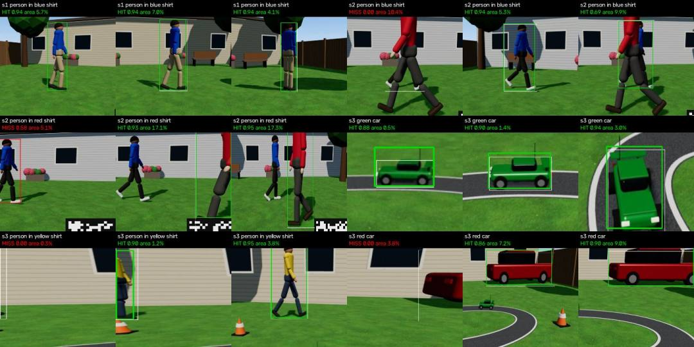

# Perception benchmarks (G1 speed; G0 for SAM; G2)

Machine: MacBook Pro M5 Pro, 48 GB, 20-core GPU, macOS 26. mlx 0.32.4, mlx-vlm 0.7.11,
SAM 3.1 MLX weights `mlx-community/sam3.1-bf16` (stored as F32, 873M parameters), OpenCV 5.0.0.

Raw results: `logs/bench_g1.json` (not in git). Reproduce:
`$MHD_ML_PY -m mhd_ml.perception.bench --images media/bench/coco --runs 30 --out logs/bench_g1.json`

## G1: SAM 3.1 MLX speed on this Mac (measured 2026-11-03 about 23:43 ET)

**What else was running:** nothing else on the GPU (ioreg GPU utilization 0% before the run). No
twin Chrome, no Glimmer/mlx_lm, no llama-server. The model downloads had finished ("ALL DONE" in
`logs/fetch.log`). Background: Cursor, a Virtualization.framework VM (about 8 GB resident),
BambuStudio idle. So these are **idle-machine numbers**; see "under load" below.

Inputs: 12 COCO val2017 images (9 with people, 3 with cars; CC BY 4.0, in `media/bench/coco`,
not in git), center-cropped to 16:9 and resized to 1280x720. Prompt "person" or "car".
3 warm-up calls, then 30 timed calls cycling through the images. Time is end to end: preprocess
(resize to the square model input + normalize), ViT backbone, heads (FPN neck, DETR encoder and
decoder, mask decoder, NMS), and conversion to boxes and polygons in 1280x720.

### Text-prompted detection

| Model input | p50 ms | p95 ms | backbone p50 | heads p50 | mean candidates | mean top score |
|---|---|---|---|---|---|---|
| 1008 (native) | **581** | **597** | 406 | 161 | 12.1 | 0.936 |
| 672 | **234** | **247** | 168 | 57 | 12.2 | 0.922 |
| 504 | **172** | **190** | 129 | 36 | 14.5 | 0.901 |
| 336 | **74** | **102** | 44 | 26 | 21.6 | 0.867 |

- Candidates counted at score > 0.25 after NMS. Lower inputs give more low-quality candidates.
- Casting the weights to bf16 changed nothing (588 ms vs 581 ms at 1008); fp16 returned no
  detections at all. So the service runs the weights as stored (F32).
- MLX memory: about 5.6 GB peak for detection only; 11.7 GB peak with the tracker session below.
- Load time: 0.2 to 1.0 s with the weights in the page cache (cold load not measured).

### SAM 3.1 multiplex tracker (track_init / track_step)

Native 1008 input only (mlx-vlm's tracker needs the 1008 feature maps). One subject, a 34-frame
synthetic camera pan (20 px per step) over the skier image, a fresh ViT backbone every step
(a moving camera needs one; mlx-vlm's "realtime" demo reuses a stale backbone, which only works
for a static camera), and the memory encoder run every step.

| Part | p50 ms | p95 ms |
|---|---|---|
| Full track step (backbone + propagate) | **980** | **1533** |
| ViT backbone | 431 | 441 |
| Propagate (memory attention + mask decoder) | 544 | 1099 |
| Session init from a detection mask | 716 (once) | |

It tracks well (mean IoU 0.96 against the known pan offset, presence score 0.996), but at
about 1 s per step it misses the 0.20 s G1 target by 5x. **Verdict: no-go for the SAM 3.1 MLX
tracker in the control loop.**

### OpenCV trackers (CPU), 640x360, same pan sequence

| Tracker | idle p50 / p95 ms | with SAM 1008 detection running in parallel, p50 / p95 ms | mean IoU vs truth | reported success |
|---|---|---|---|---|
| VitTrack (opencv_zoo 2023sep ONNX) | **2.6 / 2.7** | **2.8 / 2.9** | 0.85 | 100% |
| KCF | 26.4 / 27.1 | 28.8 / 30.9 | 0.92 | 100% |
| CSRT | 13.8 / 14.7 | 17.2 / 20.5 | 0.90 | 100% |

All three hold 5 Hz (0.20 s per step) with a wide margin, also while SAM detection keeps the
GPU busy. "Under load" here means SAM detection only: the twin's Chrome renderer and
Glimmer were not running at measurement time (only the twin and ui workstreams run Chrome, and
only train runs Glimmer). Repeat `--skip-sam` while they run to refresh the CPU tracker numbers.

### G1 decision

- **In-loop tracker: VitTrack** (`--tracker auto` picks it), KCF as the fallback, CSRT last.
  VitTrack also reports an honest score (`getTrackingScore`), which feeds `tracker_score`.
- **SAM 3.1 MLX tracker: not used in the loop** (about 1 s per step). It stays available as
  `--tracker sam_mlx` for offline replays.
- **SAM 3.1 MLX detector:** 672 input is the default (234 ms p50): 2 Hz while finding uses about
  half the GPU; 1 Hz while following about a quarter. 1008 (581 ms) cannot sustain 2 Hz.
- GPU sharing: SAM detection at 2 Hz keeps the GPU about 50% busy, which will slow Glimmer
  (train) and the twin renderer, and they will slow SAM. Measure again once they run together.

## G0 for SAM: hosted sam-3.1 through the Meta Model API (measured 2026-11-03 23:48 ET)

**Conditions:** home Wi-Fi; the model downloads had finished ("ALL DONE" in `logs/fetch.log`,
no curl running); GPU idle. Other workstreams may have been calling Meta or Fireworks APIs at
the same time (not visible from here). Same 12 COCO images and phrases as G1, one call at a
time, no streaming, `metadata: {include_confidence: "true", mask_encoding: "one_bit"}`.
Benchmark deadline 10 s (so slow calls get measured); the service uses 2.5 s.
Reproduce: `$MHD_ML_PY -m mhd_ml.perception.bench_api --n640 30 --n1280 10` (costs $0.10).

| Sent as | calls | round trip p50 ms | p95 ms | max ms | JPEG size | over 2.5 s | errors | mean objects |
|---|---|---|---|---|---|---|---|---|
| 640x360 JPEG q85 | 30 | **697** | **1277** | 1915 | 52 KB | 0 | 0 | 7.2 |
| 1280x720 JPEG q85 | 10 | **724** | **1426** | 1554 | 144 KB | 0 | 0 | 8.3 |

Parse time (special-token text to boxes and masks):

| Parser | 640x360 p50 / p95 ms | 1280x720 p50 / p95 ms |
|---|---|---|
| meta_sam_parser, as run in the benchmark (its own mask validation, then a second decode of every mask) | 481 / 1032 | 1557 / 3984 |
| meta_sam_parser alone (validates every mask: decode + re-encode, pure Python) | about 253 mean | not measured separately |
| **service path**: key-based record reader + decode only the 3 best masks | **74 / 202** | 286 / 659 |

- Mask payloads are box-local rasters at full source resolution, encoded with an adaptive range
  coder; meta_sam_parser decodes them in pure Python at about 0.8 us per pixel, so parse cost
  grows with the number and size of the objects, not with the network.
- The service's reader follows the documented grammar (parse by key) and returned records
  identical to meta_sam_parser's on all 40 recorded responses (`tests/percep/test_sam_api.py`
  replays three of them). It decodes masks with the same package's decoder.
- Sending 1280x720 instead of 640x360 costs nearly the same round trip but 3x the parse time
  for no gain at this subject size: **send 640x360**.

**G0 verdict for SAM: go at 640x360.** Round trip p95 1.28 s is within the 1.5 s gate. End to
end, with parsing, p95 is about 1.5 s, so the API detector runs at 1 Hz or less while
following, with the local tracker in between, and the 2.5 s deadline drops slow calls.
Spend: 41 calls, $0.10 (ledger `$MHD_HOME/logs/spend.jsonl`, ws "percep").

## G1 under load (measured 2026-11-04 00:11-00:13 ET)

**What else was running:** the train workstream's Glimmer LoRA job (`training/train_mlx.py`,
about 13 GB, GPU at 99-100% per ioreg), the twin's Chrome (WebGL) renderer, and other
workstreams' pytest runs. This is the "twin renders and Glimmer generates" condition of the
G1 gate, or worse (training is heavier than generation).

| What | idle (23:43) | under load (00:11) |
|---|---|---|
| SAM 3.1 MLX detect, 672 input, p50 | 234 ms | **698 ms** (min 585) |
| SAM 3.1 MLX detect, 672 input, inside the live service, p50 / p95 (46 calls) | | **625 / 695 ms** |
| SAM 3.1 MLX detect, 1008 input, p50 | 581 ms | **1406 ms** |
| VitTrack update, 640x360, p50 / p95 | 2.6 / 2.7 ms | **2.8 / 3.2 ms** |
| KCF update, p50 / p95 | 26.4 / 27.1 ms | 29.2 / 31.4 ms |
| CSRT update, p50 / p95 | 13.8 / 14.7 ms | 15.4 / 19.1 ms |

The CPU trackers are unaffected by GPU load. SAM detection slows down 2.5-3x when it shares the
GPU with Glimmer training. During real flights the plan stops the twin, the renderer and the
local LLM, so the idle numbers apply there.

## G1 accuracy proxy: look-alikes that differ only in color (00:07 ET, GPU shared with training)

Session A clips do not exist yet, so `mhd_ml.perception.bench_accuracy` builds look-alike scenes
from COCO: the same skier pasted twice at random positions and scales (one jacket red, the
other recolored blue or green with SAM's own jacket mask) on two people-free backgrounds, and
car scenes with one car recolored green. Correct = the top candidate has IoU > 0.5 with the
queried subject.

| Query | scenes | SAM top-1 correct (672) | ranked top-1 correct (672) | SAM top-1 correct (1008) | ties flagged |
|---|---|---|---|---|---|
| "person in blue/red/green shirt" (two people) | 24 queries | **24/24** | **24/24** | **24/24** | 0 |
| "green car" | 5 | 4/5 | 4/5 | 4/5 | 0 |

- SAM 3.1 separates the colors decisively: right-subject score median 0.92, best wrong-subject
  score median 0.32 (672); the smallest margin was 0.48.
- The car miss: the recolored car was dark, so it stayed nearly black after the hue change;
  SAM found no green car there.
- G1 asks for the right subject in 8 of 10 frames: **go** on these proxies (100% for people). The
  real check is on Session A clips with `mhd_ml.perception.replay`.

## End to end: the service against a fake backend (00:10-00:11 ET, same load as above)

`mhd_ml.perception.fake_backend` served a 15 fps back-and-forth pan over a two-person composite
(blue jacket on the right, red on the left), and sent FindRequest "person in blue shirt".
The service ran `--detector sam_mlx --tracker auto` (VitTrack), for 47 s.

| Measure | Result |
|---|---|
| SubjectObs rate | **15.0 Hz** (one per frame, 705 observations) |
| Perception time per frame (capture to SubjectObs out, minus the fake 80 ms camera latency) | about **10 ms** p50 |
| Time from FindRequest to the first "confirmed" | **1.4 s** |
| Frames on the right subject (IoU >= 0.5 with truth) after confirmation | **99.9%**, mean IoU 0.76 |
| Identity switches | **0** (one track id) |
| Detector latency p50 / p95 | 625 / 695 ms (GPU shared with Glimmer training) |
| confirm_age_ms while confirmed, p50 / max | 1133 / 1735 ms |
| Re-seeds accepted | 43 of 44 |

The 1 Hz follow rate plus a 625 ms detector gives a confirmation age up to about 1.7 s. The
autopilot's forward-motion rule needs less than 1.5 s, so under GPU load either raise the
follow rate (`--follow-hz 1.5`) or accept yaw-only moments. With an idle GPU (real flights,
234 ms detector) the maximum is about 1.25 s.

## G2: SAM 3.1 on twin frames that went through the full HEVC path (00:29-00:33 ET)

**Frames:** the twin's second capture in `media/shared/twin` (00:25-00:28 ET), snapshot copied
to `media/g2/` (not in git). Per the twin's README, every frame went: Three.js render, blur and
sensor noise, counter block, hevc_videotoolbox at 3 Mb/s, RTSP, cv2 decode, JPEG q95.
60 frames per scenario (every 8th render, so about 3.1 fps). Truth: one `Truth` per frame.
The counter block was masked with the twin's own ROI (1008, 640, 1280, 720).
**Load:** Glimmer LoRA training on the GPU; detector input 672 (backbone p50 about 420 ms).
Reproduce: `MHD_COUNTER_ROI=1008,640,1280,720 $MHD_ML_PY -m mhd_ml.perception.bench_g2 --twin media/g2/<snapshot>`

Hit = a detection with score >= 0.4 and IoU >= 0.5 with the actor's truth box.
"Mostly visible" = the twin's visible_frac >= 0.5 (in frame and not occluded).

| Scenario, prompt | frames visible | recall (IoU 0.5) | recall, mostly visible | median hit score | false alarms while off screen: raw / after color gate |
|---|---|---|---|---|---|
| S1 "person in blue shirt" | 60 | **100%** | 100% (60) | 0.95 | none off screen |
| S2 "person in blue shirt" | 60 | **98.3%** | 100% (56) | 0.95 | none off screen |
| S2 "person in red shirt" | 24 | 83.3% | 100% (17) | 0.92 | **34 of 36 -> 0** |
| S3 "green car" (toy RC car, 0.5-4% of the frame) | 60 | **100%** | 100% (60) | 0.94 | none off screen |
| S3 "person in yellow shirt" | 52 | 86.5% | 100% (45) | 0.94 | 0 of 8 |
| S3 "red car" | 32 | 84.4% | 100% (18) | 0.91 | 0 of 28 |

**G2 verdict: go.** S1 recall is 100% against the 90% gate, and every actor that is at least half
visible is found in every frame. Every miss is an actor cut by the frame edge or hidden behind
the other walker (example crops below).

**The color gate (found here, fixed in `pipeline.py`).** With the red walker off screen,
"person in red shirt" boxes the blue walker with scores 0.47-0.72 (true hits score 0.92). Ranking
by color alone cannot stop this, because there is no other candidate. So candidates whose
upper-body mask region matches the requested color in less than 8% of its pixels are dropped.
On these frames that removes all 34 false alarms and none of the true detections.
`tests/percep/test_pipeline.py::test_wrong_color_detection_never_becomes_a_track` covers it.

The first capture (00:17-00:20 ET, smaller subjects) gave lower IoU-based recall for the blue
walker (54-57%). That was not a detection failure: SAM found it in every frame at score 0.95, but
its box spanned the walker's full stride, and that capture's truth boxes were about half as wide
(IoU 0.40-0.45). The twin re-captured at 00:25.

### The full pipeline on the twin frames (replay, SAM MLX 672 + VitTrack, 3.1 fps)

`$MHD_ML_PY -m mhd_ml.perception.replay --input media/g2/<snapshot>/s2 --phrase "person in blue shirt" --color blue --fps 3.125 --flight-mode twin --truth .../s2/truth.jsonl`

| Scenario, subject | time to confirmed | identity switches | locked (IoU >= 0.5) after confirmation | boxed with IoU >= 0.3 after confirmation |
|---|---|---|---|---|
| S1 blue walker | 2.2 s | 0 | 86.8% | **100%** (46 >= 0.5, 7 at 0.3-0.5) |
| S2 blue walker, red one crossing in front | 1.9 s | **0** | **92.6%** | |
| S3 green RC car | 2.2 s | 0 | **100%** | |
| S2 red walker (visible 24 frames, close and fast) | 5.4 s | 0 | 60% | 87% |

These saved frames are only 3.1 fps, so the tracker sees 8 render frames of motion per step.
Live at 25 fps it has an easier job.

### G2 with the hosted sam-3.1 (00:35-00:39 ET, every 3rd frame of the same snapshot)

`... bench_g2 --detector sam_api --every 3 [--pace-s 0.6]`: 640x360 JPEG, same scoring.

| Scenario, prompt | frames visible | recall (IoU 0.5) | recall, mostly visible |
|---|---|---|---|
| S1 "person in blue shirt" | 20 | **100%** | 100% |
| S2 "person in blue shirt" | 20 | **100%** | 100% |
| S2 "person in red shirt" | 8 | 62.5% | 83% |
| S3 "green car" | 20 | **95%** (the one miss was an HTTP 429) | 95% |
| S3 "person in yellow shirt" | 18 | 83% | 100% |
| S3 "red car" | 11 | 82% | 100% |

On these frames the hosted model matches the MLX one. **Rate limits:** the team key returned
**HTTP 429** twice, once at only 1.7 calls/s. The 3,000 RPM limit is per team, and other
workstreams were using the same key. The first unpaced S3 run was spoiled by the 5 s back-off
that followed (recall near 0, discarded). On flight day, keep batch jobs off the key while
`--detector sam_api` flies; a 429 costs 5 s of detections, and the autopilot then hovers.
Spend for G2 via API: $0.31 (124 calls). Workstream total so far: $0.46.

### Adaptive follow cadence (00:44 ET, Glimmer training on the GPU, twin Chrome not running)

The first live run showed `confirm_age_ms` reaching 1.7 s under GPU load, above the
autopilot's 1.5 s forward-motion gate. While following, the detector period is now
`max_confirm_age_ms (1300) - detector p95`, between the 2 Hz find rate and 1 Hz. Same fake
backend run, 38 s:

| | fixed 1 Hz (00:10) | adaptive (00:44) |
|---|---|---|
| confirm_age p50 / p95 / max | 1133 / about 1650 / 1735 ms | **999 / 1332 / 1467 ms** |
| frames over 1.5 s | about 10% | **0%** |
| detector rate while following | 1.0 Hz | about 1.45 Hz (p95 727 ms) |

With an idle GPU (detector p95 about 250 ms) the period stays at 1 s.
