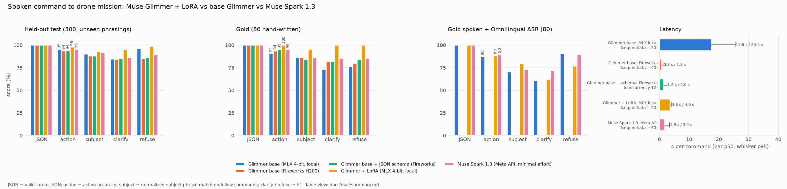

# Results

Every number here was measured on one MacBook Pro (M5 Pro, 20-core GPU, 48 GB, macOS 26) during the
night of 2026-11-03/04 ET. Each table says what else was running and where the raw data is. Paths
under `logs/` and `media/` are in the main checkout and are not in git (they hold run logs and
frames). Where a number appears in two places, this page uses the newer one.

**Not measured yet:** anything on the real drone. Session A (props off) and Sessions B and C
(props on) run on the morning of Nov 4; the camera latency, field of view, yaw rate, deadband and
link-loss behavior below are twin values or guesses until then.

Contents: [twin end to end](#1-twin-end-to-end) · [perception](#2-perception-gates-g0-g1-g2) ·
[intent model](#3-intent-model-training-and-evaluation) · [voice](#4-voice) ·
[latency budget](#5-latency-budget) · [governor](#6-safety-governor-tests-and-review) ·
[test suites and spend](#7-test-suites-and-spend)

## 1. Twin end to end

`scripts/e2e_twin.py` starts the wire-level twin (Three.js in Chrome, counter block, HEVC through
`hevc_videotoolbox`, RTSP through mediamtx), the governed turbodrone backend, and perception. It
takes off, posts a follow Mission, records telemetry while following, lands, confirms touchdown,
and scores the run against the twin's ground truth with `mhd.twin.metrics`. Every run below used a
500 ms total video latency set point, HFOV 75 degrees, and headless twin mode (no UI heartbeat).

Metric definitions (`src/mhd/twin/metrics.py`):
- **bearing RMS**: RMS of the subject's true bearing from the image center while perception is
  locked on it. This is control quality: 0 means the subject stays dead center.
- **perception bearing error**: RMS of observed minus true bearing on matched frames.
- **lock rate**: frames where the observed box overlaps the subject's true box (IoU at least 0.3),
  over frames where the subject is at least half visible, after the first lock.
- **identity switches**: changes of the best-matching true actor between identified frames.
- **settling time**: from the first lock until the true bearing stays within 0.1 rad for 2 s.
- **time in FOLLOW**: autopilot state sampled every 0.5 s during the follow phase.

Source for every row: `logs/e2e-<stamp>-<scenario>-<perception>/e2e_result.json` (summary and
metrics), `report.json` (metrics), `rows.csv` (per frame), `telemetry.jsonl`, `obs.jsonl`.

### 1a. Oracle tuning progression (S1)

Oracle perception (`mhd.twin.oracle`): SubjectObs from the twin's ground truth, 300 ms after render,
4 px box noise, 3% dropouts, found 1.2 s after the request and confirmed 0.8 s later. About 45 s of
following per run. These runs tuned the autopilot and governor before SAM went into the loop.

| Run (ET) | Configs and code | Bearing RMS | Subject at least half visible | Lock rate | Pitch wrong-way flag (telemetry samples) | Settling |
|---|---|---|---|---|---|---|
| 02:30 `e2e-20261104-023015-s1-oracle` | real-drone defaults (`config/*.yaml`) | 0.338 rad | 1,146 of 1,312 frames | 0.929 | 412 of 547 | 16.6 s |
| 02:40 `e2e-20261104-024054-s1-oracle` | twin calibration (`config/twin/`) | 0.260 rad | 725 of 1,312 | 0.972 | 322 of 546 | 7.2 s |
| 02:47 `e2e-20261104-024753-s1-oracle` | plus gait-robust pitch check, width low-pass, two-frame doubt debounce (`6fb3ba9`); P-only yaw | 0.130 rad | 1,278 of 1,310 | 0.960 | 0 | 7.2 s |

What the first two runs showed (commit `6fb3ba9`): the pitch wrong-way check latched a hover on a
correctly flying drone, because a walker's box width swings with its gait and a receding walker
shrinks the box while the drone, still under its cap, falls behind. The check now compares median
widths over a longer window, must persist 0.5 s, and fires only near the forward cap. A reversed
pitch sign still trips it (after about 4.1 s). The forward/back loop low-passes the box width
(0.6 s), and one doubtful frame no longer stops the drone (two in a row do).

### 1b. Feed-forward robustness (S1, oracle)

Feed-forward on yaw, gain 0.6, low-pass 0.6 s. The autopilot's assumed yaw rate per count (K) was
set right, 30% low and 30% high against the twin's true value (0.0166 rad/s per count). Configs:
`logs/ffcfg/ff_k070.yaml`, `ff_k100.yaml`, `ff_k130.yaml`. PLAN.md required this test before
turning feed-forward on (section 4.4).

| Run (ET) | Assumed K | Bearing RMS | Lock rate | Settling | DOUBT samples |
|---|---|---|---|---|---|
| 02:47 `e2e-20261104-024753-s1-oracle` | P-only (no feed-forward) | 0.130 rad | 0.960 | 7.2 s | 2 |
| 02:49 `e2e-20261104-024947-s1-oracle` | 1.0 x true | **0.075 rad** | 0.966 | 3.8 s | 1 |
| 02:50 `e2e-20261104-025051-s1-oracle` | 0.7 x true | **0.062 rad** | 0.953 | 2.0 s | 2 |
| 02:51 `e2e-20261104-025155-s1-oracle` | 1.3 x true | **0.089 rad** | 0.963 | 5.0 s | 2 |

No ringing, never LOST. Result: feed-forward is on in the twin config (`f86ca79`). The real-drone
config keeps it off until Session B measures K.

The in-process closed-loop sim (`mhd.autopilot.sim`, governor plus a kinematic X69, 15 fps camera,
subject at 3.2 m) gave the same picture before the wire-level runs (docs/ws/gov.md):

| Total delay theta | Yaw step 20 deg: overshoot / settle | S1 RMS, P-only | S1 RMS, feed-forward | Feed-forward with K +/-30%: worst overshoot / S1 RMS |
|---|---|---|---|---|
| 0.6 s | 0% / 2.0 s | 0.083 rad | 0.040 | 2.5% / 0.055 |
| 1.0 s | 0% / 3.1 s | 0.135 rad | 0.066 | 0% / 0.093 |
| 1.5 s | 0% / 4.6 s | 0.196 rad | 0.104 | 0% / 0.139 |

A walker crossing at 0.3 rad/s (0.96 m/s at 3.2 m) is not held in frame in the sim (40-80% in
frame), with or without feed-forward: the loop is delay-limited, and SEARCH reacquires.

### 1c. SAM 3.1 in the loop (S1-S3)

Perception: `mhd_ml.perception.service --detector sam_mlx --tracker auto` (SAM 3.1 MLX at a 672
input, VitTrack, Kalman filter). Twin-calibrated configs with feed-forward on. 60 s of following.
The twin's Chrome renderer shared the GPU.

| | S1 | S2 | S3 |
|---|---|---|---|
| Run (ET) | 02:58 `e2e-20261104-025845-s1-sam_mlx` | 03:00 `e2e-20261104-030039-s2-sam_mlx` | 03:02 `e2e-20261104-030221-s3-sam_mlx` |
| Scene | one walker in a blue shirt looping across a backyard lawn at 0.3 m/s | blue and red shirts walking opposite ways; the red walker passes between the drone and the subject | green RC car lapping a private track at 0.3 m/s, a walker in yellow, a parked red car |
| Subject phrase | "person in blue shirt" | "person in blue shirt" | "green car" |
| Takeoff to AIRBORNE (the governor's 4 s takeoff hold) | 4.06 s | 4.07 s | 4.06 s |
| Mission to FOLLOW | 1.57 s | 2.51 s | 1.55 s |
| Time to first confirmed lock (metric) | 0.80 s | 1.32 s | 0.80 s |
| Time in FOLLOW | 119 of 119 samples | 118 of 119 (1 DOUBT) | 119 of 119 |
| Bearing RMS | **0.092 rad** | **0.103 rad** | **0.089 rad** |
| Perception bearing error RMS | 0.019 rad | 0.019 rad | 0.005 rad |
| Lock rate | 0.955 | 0.942 | 0.960 |
| Subject at least half visible | 1,679 of 1,679 frames | 1,609 of 1,706 | 1,678 of 1,678 |
| Frames matched to another actor | 0 | 49 of 1,706 (2.9%), red walker | 0 |
| Identity switches / track-id changes | 0 / 0 | 14 / 1 | 0 / 0 |
| Settling time | 0.0 s | 5.0 s | 2.2 s |
| SAM detections with latency, p50 / p95 | 64, 241 / 247 ms | 66, 242 / 246 ms | 64, 242 / 244 ms |
| Confirmation age while confirmed, p50 / p95 / max | 760 / 1,238 / 1,282 ms | 760 / 1,240 / 1,800 ms | 761 / 1,240 / 1,427 ms |
| VitTrack score while confirmed, p5 / p50 | 0.59 / 0.76 | 0.51 / 0.72 | 0.61 / 0.79 |
| Twin video latency, p50 / p95 (set point 500 ms) | 501.6 / 505.4 ms | 501.8 / 505.3 ms | 501.6 / 506.5 ms |
| RC packet inter-arrival p50 / p99 / max (p99 alarm at 60 ms) | 40.3 / 48.9 / 49.8 ms | 40.4 / 48.1 / 49.5 ms | 40.1 / 48.9 / 118.5 ms |

**S2, the crossing.** The 49 frames on the red walker came in three episodes about 21 s apart,
which is how often the two walkers cross (each walks 6 m at 0.3 m/s and pauses 1 s): 11 frames
(0.4 s) at 21.7 s, five flickers of 1-4 frames at 41-43 s, and 30 frames (1.2 s) at 63-64 s, in
seconds from the start of the scored log (`rows.csv`, columns `t_s` and `identity`). The 14 identity switches are those seven episodes counted in and
out. Perception kept one track until the last episode, then started a new track, which went back
through CONFIRM.

**Before the last fix.** The first SAM run (02:53, `e2e-20261104-025318-s1-sam_mlx`) latched a hover:
the backward half of the pitch wrong-way check fired when the walker approached faster than the
deliberately slow back-off, so the box grew while the drone backed up (`wrong_way:pitch` in 463 of
684 telemetry samples; bearing RMS 0.239 rad). Commit `6bb13fb` turned the backward half off by
default; the 1 m backward-travel budget and the standoff rule bound that case, and the forward half
(the blind runaway) stays on.

### 1d. The whole chain with voice (demo take, S1)

The demo workstream's `scripts/demo_twin.py` runs the same stack plus the voice agent, the Glimmer
server and the operator UI (production build, real UI heartbeat, so not headless). The operator's
command is a `say` recording fed into the agent's microphone input. Take `demo-20261104-032416-s1`
(03:24 ET; `logs/demo-20261104-032416-s1/demo_result.json` in the ws2/demo worktree):

| Step | Result |
|---|---|
| Spoken: "Drone, follow the person in the blue shirt." | Muse Voice Transcribe final: "drone, follow the person in the blue shirt." (177.5 ms ASR time) |
| Mission | from `glimmer-30b+lora` (our LoRA on the Mac) in 4,029.7 ms: follow, "person in blue shirt", person, blue, medium |
| Button release to the mission card in the UI | 4.3 s |
| Mission card to autopilot FOLLOW | 0.53 s |
| Following (36.6 s window) | subject in frame 100% of 915 frames, bearing RMS 0.084 rad (max 0.132), locked 100%, 0 frames on another actor, FOLLOW throughout |
| Whole run (56.4 s scored) | bearing RMS 0.125 rad, lock rate 0.953, 0 identity switches |
| Spoken: "Okay drone, please land now." | the local listener heard "oky drone please land now", decoded in 270.1 ms, and the governor went to LANDING |

Final numbers for the demo takes are the demo workstream's (docs/ws2/demo.md once merged).

## 2. Perception gates (G0, G1, G2)

Source: [docs/benchmarks-perception.md](benchmarks-perception.md) and
[docs/ws/percep.md](ws/percep.md); raw results in `logs/bench_g1.json` and the `media/g2/` snapshot.
Software: mlx 0.32.4, mlx-vlm 0.7.11, SAM 3.1 MLX weights `mlx-community/sam3.1-bf16` (stored as
F32, 873M parameters), OpenCV 5.0.0.

### G1 speed: SAM 3.1 MLX detection (23:43 ET, idle GPU)

12 COCO val2017 images at 1280x720, prompt "person" or "car", 30 timed calls after 3 warm-ups, end
to end (preprocess, ViT backbone, heads, boxes and polygons).

| Model input | p50 | p95 | backbone p50 | heads p50 |
|---|---|---|---|---|
| 1008 (native) | 581 ms | 597 ms | 406 ms | 161 ms |
| **672 (the default)** | **234 ms** | 247 ms | 168 ms | 57 ms |
| 504 | 172 ms | 190 ms | 129 ms | 36 ms |
| 336 | 74 ms | 102 ms | 44 ms | 26 ms |

Memory: about 5.6 GB peak for detection. bf16 weights were no faster (588 vs 581 ms at 1008); fp16
found nothing.

### G1 speed: trackers (640x360, 34-frame pan)

| Tracker | idle p50 / p95 | with SAM detection running | mean IoU vs truth |
|---|---|---|---|
| **VitTrack** (opencv_zoo 2023sep ONNX) | **2.6 / 2.7 ms** | 2.8 / 2.9 ms | 0.85 |
| KCF | 26.4 / 27.1 ms | 28.8 / 30.9 ms | 0.92 |
| CSRT | 13.8 / 14.7 ms | 17.2 / 20.5 ms | 0.90 |
| SAM 3.1 MLX multiplex tracker (1008) | 980 / 1,533 ms per step | not measured (out of GPU memory next to Glimmer training) | 0.96 |

Gate: a tracker step of 0.20 s or less. VitTrack goes in the loop; the SAM 3.1 MLX tracker is a
no-go (5x too slow) and stays available for offline replays.

### G1 under load (00:11 ET, Glimmer LoRA training at 99-100% GPU, twin Chrome renderer)

| What | idle | under load |
|---|---|---|
| SAM 3.1 MLX detect, 672, p50 | 234 ms | 698 ms |
| same, inside the live service, p50 / p95 (46 calls) | | 625 / 695 ms |
| SAM 3.1 MLX detect, 1008, p50 | 581 ms | 1,406 ms |
| VitTrack update p50 / p95 | 2.6 / 2.7 ms | 2.8 / 3.2 ms |

### G1 accuracy proxy (00:07 ET)

Session A clips did not exist yet, so look-alike scenes were built from COCO: the same skier pasted
twice, one jacket recolored with SAM's own mask; car scenes with one car recolored green.

| Query | Scenes | SAM top-1 correct (672) | Ranked top-1 correct (672) | SAM top-1 correct (1008) |
|---|---|---|---|---|
| "person in blue/red/green shirt" (two people) | 24 | 24/24 | 24/24 | 24/24 |
| "green car" | 5 | 4/5 | 4/5 | 4/5 |

Right-subject score median 0.92, best wrong-subject median 0.32. The car miss: the recolored car
was dark and stayed nearly black. Gate (8 of 10): go on the proxy; the real gate needs Session A clips.

### G0: hosted `sam-3.1` through the Meta Model API (23:48 ET, home Wi-Fi)

| Sent as | Calls | p50 | p95 | max | Over 2.5 s | Errors |
|---|---|---|---|---|---|---|
| **640x360 JPEG** | 30 | **697 ms** | **1,277 ms** | 1,915 ms | 0 | 0 |
| 1280x720 JPEG | 10 | 724 ms | 1,426 ms | 1,554 ms | 0 | 0 |

Parse time: `meta_sam_parser` as benchmarked 481 / 1,032 ms (p50 / p95, 640x360); the service's
key-based reader decoding only the 3 best masks 74 / 202 ms (identical records on all 40 recorded
responses). Gate (p95 1.5 s or less): go at 640x360. The team key returned HTTP 429 at only 1.7
calls/s while other jobs used it.

### G2: SAM 3.1 on twin frames after the full HEVC path (00:29-00:39 ET)

60 frames per scenario (every 8th render), counter block masked, Glimmer training on the GPU.
Hit = score at least 0.4 and IoU at least 0.5 with the actor's true box.

| Scenario, prompt | Frames visible | MLX recall | MLX recall, mostly visible | Hosted API recall (every 3rd frame) |
|---|---|---|---|---|
| S1 "person in blue shirt" | 60 | **100%** | 100% | 100% (20) |
| S2 "person in blue shirt" | 60 | 98.3% | 100% | 100% (20) |
| S2 "person in red shirt" | 24 | 83.3% | 100% | 62.5% (8) |
| S3 "green car" (0.5-4% of the frame) | 60 | **100%** | 100% | 95% (20; the miss was an HTTP 429) |
| S3 "person in yellow shirt" | 52 | 86.5% | 100% | 83% (18) |
| S3 "red car" | 32 | 84.4% | 100% | 82% (11) |

Gate: 90% recall in S1. Go. Every miss was an actor cut by the frame edge or hidden behind the
other walker. The color gate found here: with the red walker off screen, "person in red shirt"
boxed the blue walker (scores 0.47-0.72), so candidates whose shirt region matches the requested
color in under 8% of its pixels are dropped. That removed 34 of 34 false alarms and no true hits.

### Perception service end to end, before the twin (00:10 ET, GPU shared with training)

Fake backend serving a 15 fps pan over two look-alikes, FindRequest "person in blue shirt":

| Measure | Result |
|---|---|
| SubjectObs rate | 15.0 Hz (one per frame) |
| Time inside perception per frame | about 10 ms p50 |
| FindRequest to first "confirmed" | 1.4 s |
| Frames on the right subject after confirmation | 99.9% |
| Identity switches | 0 in 47 s |
| Detector p50 / p95 | 625 / 695 ms |

With `sam_api`: 15 Hz, 97.5% locked, confirmed after 2.1 s, API p50 645 ms. With the adaptive
follow cadence (detector period = 1.3 s minus detector p95), confirmation age p50 / p95 / max was
999 / 1,332 / 1,467 ms, under the autopilot's 1.5 s forward-motion gate.

## 3. Intent model: training and evaluation

Source: [docs/ws/train.md](ws/train.md), [docs/eval/summary.md](eval/summary.md),
`docs/eval/results.json`, chart [docs/eval/intent_eval.png](eval/intent_eval.png). Raw predictions:
`logs/eval/*.jsonl`.

**Data** (`training/generate.py`): 2,200 train, 150 valid and 300 test examples from 77 template
families, split by family (55 train, 11 valid, 11 test), so the test set is unseen phrasings. Labels
come from the template slots, never from a model. ASR-style noise is added, and 458 paraphrases of
seed sentences by Muse Spark 1.3 were kept (wording only; a filter drops any that add or lose a
color, garment, vehicle, animal, name or distance). The gold set is 80 hand-written,
hand-labeled commands, never trained on. The spoken gold set is the same 80 spoken by `say`
(6 English accents) and transcribed by Omnilingual ASR.

**Training:** Fireworks refused every dataset upload ("dataset uploads are temporarily disabled,
please contact Fireworks AI to get access"; rechecked at 00:27, 01:00, 01:37 and 02:00 ET) and every
model upload ("model creation, uploads and preparation are temporarily disabled"), so no Fireworks
SFT job could start. The LoRA was trained on the Mac instead: MLX QLoRA
on `Muse-Glimmer-30B-4bit`, last 16 layers, rank 16, scale 2.0, dropout 0.05, learning rate 1e-4
with cosine decay to 1e-5, batch 1 with 4-step accumulation. 2,600 iterations in 4,595 s (76.6
minutes), MLX peak memory 17.68 GB, validation loss 1.426 at the start and 0.001 at the end.
32.2M trainable parameters (0.116%).

Scoring: `mhd.intent_spec.parse_intent` on the final channel, as the agent parses. Invalid replies
count as wrong. Subject, category, color and distance are scored on follow examples only.

**Held-out test (300 unseen phrasings)**

| Model | n | Valid JSON | Action | Subject exact | Subject normalized | Clarify F1 | Refuse F1 | Land/hover |
|---|---|---|---|---|---|---|---|---|
| **Glimmer + LoRA (MLX 4-bit, local)** | 300 | 100.0% | **98.0%** | **92.9%** | 92.9% | 0.95 | 0.99 | 98.0% |
| Glimmer base (Fireworks H200) | 300 | 100.0% | 93.7% | 41.4% | 88.2% | 0.84 | 0.85 | 94.1% |
| Glimmer base + JSON schema (Fireworks) | 300 | 100.0% | 94.0% | 40.8% | 88.2% | 0.85 | 0.86 | 94.1% |
| Glimmer base (MLX 4-bit, local) | 100 (first 100) | 100.0% | 95.0% | 35.3% | 90.2% | 0.85 | 0.97 | 90.9% |
| Muse Spark 1.3 (Meta API, minimal effort) | 300 | 100.0% | 95.3% | 52.7% | 91.7% | 0.86 | 0.89 | 96.1% |

On the same first 100 test rows, base Glimmer on MLX scored 95.0% and the LoRA 97.0%.

**Gold (80 hand-written)**

| Model | Valid JSON | Action | Subject exact | Clarify F1 | Refuse F1 | Land/hover |
|---|---|---|---|---|---|---|
| **Glimmer + LoRA (MLX 4-bit, local)** | 100.0% | **100.0%** | 93.2% | 1.00 | 1.00 | 100.0% |
| Glimmer base (Fireworks H200) | 100.0% | 93.8% | 47.7% | 0.82 | 0.80 | 100.0% |
| Glimmer base + JSON schema (Fireworks) | 100.0% | 95.0% | 45.5% | 0.82 | 0.84 | 100.0% |
| Glimmer base (MLX 4-bit, local) | 100.0% | 91.2% | 50.0% | 0.73 | 0.76 | 93.8% |
| Muse Spark 1.3 (Meta API, minimal effort) | 100.0% | 95.0% | 52.3% | 0.86 | 0.86 | 100.0% |

**Gold spoken through `say` and Omnilingual ASR (80)**: the LoRA's weak spot.

| Model | Valid JSON | Action | Subject exact | Clarify F1 | Refuse F1 | Land/hover |
|---|---|---|---|---|---|---|
| Glimmer + LoRA (MLX 4-bit, local) | 100.0% | 88.8% | 77.3% | 0.62 | 0.77 | **93.8%** |
| Glimmer base (MLX 4-bit, local) | 100.0% | 87.5% | 38.6% | 0.61 | 0.91 | 75.0% |
| Muse Spark 1.3 (Meta API, minimal effort) | 100.0% | **90.0%** | 38.6% | 0.72 | 0.90 | 87.5% |

**Latency per command, one request at a time** (client wall time)

| Model | p50 | p95 | n | Conditions |
|---|---|---|---|---|
| Glimmer + LoRA (MLX 4-bit, local) | **3,606 ms** | 4,017 ms | 40 | `mlx_lm.server` on the Mac; the twin renderer may have shared the GPU |
| Glimmer base (MLX 4-bit, local) | 17,580 ms | 25,525 ms | 20 | same; base Glimmer reasons for about 230 tokens, the LoRA emits 47 |
| Glimmer base (Fireworks H200) | 828 ms | 1,250 ms | 40 | home Wi-Fi; 1 replica |
| Muse Spark 1.3 (Meta API, minimal) | 1,871 ms | 3,403 ms | 40 | home Wi-Fi |

Where the LoRA still fails: unintelligible transcripts are refused as `unsupported` where gold says
`clarify`; a wake word misheard as "drown" flipped one command to `refuse/unsafe`; on the test set,
"keep yuki in frame" was followed instead of refused, "follow that car" was treated as pointing,
"lend it" (for "land it") went to clarify, and "follow perple one" was followed instead of
clarified. Every miss is a non-motion answer or a follow of the right category.

Fireworks was used for one H200 deployment of base Glimmer: 8.3 GPU-minutes, about $1.10, deleted
after the evaluation.

## 4. Voice

Source: [docs/ws/agent.md](ws/agent.md). Cloud numbers: home Wi-Fi, 00:20-01:53 ET, with MLX LoRA
training on the GPU, the perception service, and Playwright Chrome running. Not yet repeated over
the phone tether used for flights.

### G0: Muse Spark 1.3 (strict JSON schema, streamed, 20 varied commands per effort)

| Effort | p50 | p95 | Valid | Right action | Completion tokens (reasoning) | Cost per 20 |
|---|---|---|---|---|---|---|
| **minimal** | **1.64 s** | **2.47 s** | 20/20 | 20/20 | 178 (139) | $0.026 |
| low | 3.58 s | 4.50 s | 20/20 | 20/20 | 421 (382) | $0.047 |

Gate (p95 4 s or less): go at minimal, the default.

### G0: Muse Voice Transcribe (`say` voice, button released 150 ms after speech)

End of speech to final transcript:

| Path | 24 kHz p50 / p95 (n=10) | 16 kHz p50 / p95 (n=5) | Exact transcripts |
|---|---|---|---|
| **realtime, session per utterance** | **226 / 267 ms** | 245 / 253 ms | 10/10 |
| realtime, warm persistent session | 239 / 279 ms | 220 / 227 ms | 10/10 |
| file endpoint | 913 / 1,126 ms | 895 / 1,246 ms | 8/10 (doubled words) |

Gate (1 s or less): go with realtime. Socket connect and handshake take 375 ms p50, hidden because
the socket opens when the button goes down.

### Push-to-talk acceptance (PLAN.md 4.6): 20 scripted commands through the real service

Warm Voice Transcribe, Spark at minimal (no Glimmer deployment existed at the time), the keyword
fast path for bare safety commands, MMS-TTS synthesized but muted, fake backend.

| Run | Release to reply start, p50 / p95 | Release to final transcript, p50 | Release to intent, p50 / p95 | Right mission |
|---|---|---|---|---|
| 00:24 | 2.35 / 3.35 s | 210 ms | 2.11 / 2.92 s | 20/20 |
| 01:37 (final code) | **2.40 / 3.97 s** | 236 ms | 2.11 / 3.75 s | **20/20** |

Acceptance bar: p50 4 s or less, p95 6 s or less, 18 of 20 right. Pass.

### Local safety listener (silero VAD + Omnilingual ASR CTC-300M, CPU, 2 threads)

| Test | Result |
|---|---|
| Spoken safety clips detected | **18/18** |
| False triggers on 20 ordinary sentences | **0/20** |
| Latency after speech end | p50 about 0 s (partial decodes catch the word before the segment closes), worst 0.62 s |
| One decode with the English carrier phrase | 0.19 s mean |
| Spoken "land" during flight, through the whole service, to the backend | within 1.5 s of speech end (test) |

Synthetic propeller noise (four motor tones, harmonics, broadband; 17 safety clips):

| SNR | clean | 15 dB | 10 dB | 5 dB | 0 dB |
|---|---|---|---|---|---|
| detected | 17 | 16 | 13 | 6 | 0 |
| worst latency | 0.62 s | 0.79 s | 0.74 s | 0.74 s | - |

No false triggers at any SNR. Real propeller noise is measured in Session B with `mic_check`; below
about 10 dB SNR, use a headset.

Soak, 6 minutes (real Voice Transcribe and Spark, one command every 30 s): memory flat at 1.98 GB,
10 missions and 4 safety commands delivered, no errors. MMS-TTS: 0.12-0.47 s per reply after the
warm-up (torch import 2.3 s, model load 0.4 s).

## 5. Latency budget

### Voice to motion

| Step | Measured | Source |
|---|---|---|
| End of speech to final transcript (Voice Transcribe realtime) | 226 ms p50, 267 ms p95 | 4, G0 |
| Transcript to valid mission, Muse Spark 1.3 minimal | 1.64 s p50, 2.47 s p95 | 4, G0 |
| Transcript to valid mission, Glimmer + LoRA on the Mac | 3.6 s p50, 4.0 s p95 | 3 |
| Transcript to valid mission, base Glimmer on Fireworks H200 | 0.83 s p50, 1.25 s p95 | 3 |
| Button release to intent (whole agent, Spark) | 2.11 s p50, 3.75 s p95 | 4 |
| Button release to the start of the spoken reply | 2.40 s p50, 3.97 s p95 | 4 |
| Mission to autopilot FOLLOW in the twin (SAM 3.1 MLX) | 1.55-2.51 s | 1c |
| Spoken "stop" or "land" to the governor (local listener) | about 0 s p50, worst 0.62 s after speech end | 4 |

Router budget (`config/agent.yaml`): Glimmer's answer wins if it is valid within 2.5 s, otherwise
the first valid answer; the keyword grammar answers at 5 s (9 s when Glimmer runs locally).

### Control loop (twin, S1 with SAM 3.1)

| Part | Measured | Source |
|---|---|---|
| Camera to backend, total video latency | 501.6 ms p50, 505.4 ms p95 (500 ms set point); the twin's own pipeline is about 137 ms of it | 1c |
| Frame age at the backend while following | 519 ms p50, 543 ms p95 | `telemetry.jsonl` |
| Observation age at the governor while following | 535 ms p50, 551 ms p95 | `telemetry.jsonl` |
| Perception per frame (VitTrack and Kalman) | about 10 ms p50; VitTrack 2.6-2.8 ms | 2 |
| SAM 3.1 detection (off the per-frame path) | 241 ms p50, 247 ms p95 | 1c |
| Detector confirmation age while following | 760 ms p50, 1,238 ms p95 (forward-motion gate 1.5 s) | 1c |
| Observation period | 40 ms (25 fps) | `telemetry.jsonl` |
| RC period | 40 ms; inter-arrival p99 48.9 ms | 1c |
| Governor tick | 41 us p50, 70 us p99 (CPU) | 6 |
| Loop delay theta assumed by the autopilot | 1.0 s (`config/autopilot.yaml`; PLAN expects 0.85-1.2 s on the drone) | config |

One finding changed this budget: OpenCV's default FFmpeg decoder threading adds about 0.6 s of
video latency (backend `/mjpeg` p50 697 ms with default threads vs. 102 ms with
`OPENCV_FFMPEG_THREADS=1`, twin with no injected delay). The backend now sets one decoder thread by
default, for the twin and the drone.

### Operator safety paths

| Path | Measured | Source |
|---|---|---|
| Esc key to E-STOP at the backend, WebSocket | 1.0 ms p50, 4.1 ms p95 | docs/ws/ui.md |
| Esc key to E-STOP at the backend, HTTP fallback | 2.4 ms p50, 3.7 ms p95 | docs/ws/ui.md |
| Backend state change to the UI | 87 ms p50, 110 ms p95 | docs/ws/ui.md |
| UI heartbeat interval (Web Worker) | 199.8 ms p50, 206.4 ms p95 | docs/ws/ui.md |
| Heartbeat gap across a page reload | 317 ms (neutral threshold 1.5 s) | docs/ws/ui.md |
| Perception killed mid-follow to neutral sticks on the wire | 0.42-0.44 s (PLAN: 0.5 s) | 6 |
| Ctrl-C to the first land packet | 3 ms; 29 land packets over 1.1 s | 6 |

The real drone's camera latency is measured in Session A with the screen counter page
(`mhd.twin.screen_counter`); PLAN.md reports about half a second from other users.

## 6. Safety governor: tests and review

Source: [docs/ws/gov.md](ws/gov.md).

**Tests.** `tests/gov`: 185 tests, all passing on `integration` (docs/STATUS.md, 03:10 ET). At the
end of the review-fix pass (02:20 ET) there were 179:

| Group | Tests |
|---|---|
| review regression tests (`test_review_fixes.py`) | 70 |
| governor rules, one or more per rule | 42 |
| autopilot lifecycle and geometry | 14 |
| closed-loop sim | 15 |
| FastAPI TestClient (including CORS and Origin) | 17 |
| turbodrone glue | 7 |
| capture clock | 4 |
| Session B system identification | 4 |
| live backend (uvicorn, RTSP, UDP drone stand-in; Ctrl-C with /mjpeg open) | 3 |
| UDP wire (paced and upstream FlightController) | 2 |
| RTSP integration (mediamtx with an ffmpeg HEVC stream) | 1 |

The twin-tuning commits (`6fb3ba9`, `6bb13fb`) added the other 6. Upstream turbodrone's x69_lg
unit tests: 15 passed.

**Measurements**

| What | Result |
|---|---|
| Governor tick CPU time, following, tick log on | p50 41 us, p99 70 us, max 192 us (after the review fixes) |
| RC inter-arrival, our paced loop | p50 40.4 ms, p99 48.3 ms (25 Hz); upstream's loop: p50 47.7, p99 63.0 ms (20.7 Hz) |
| Perception killed mid-follow, to neutral sticks on the wire | 0.42-0.44 s |
| Land re-assert | 10 land packets in 2 s, evenly spaced |
| Latched E-stop with 50% simulated packet loss | every received packet is E-stop with neutral sticks |
| Ctrl-C with a client holding /mjpeg open, AIRBORNE | first land packet 3 ms after SIGINT, 29 land packets over 1.1 s, exit after 2.3 s |
| Same with a second Ctrl-C 50 ms later | first land 41 ms, 15 land packets over 0.6 s, exit after 0.7 s |
| Real-mode latency creeping 0.5 to 3.5 s over 60 s | autopilot neutral at 10.7 s, video stale at 14.4 s, safety landing at 43.0 s |
| Lasting +1.5 s latency step | neutral 1.0 s after the step, held for the rest of the run |
| Reversed yaw sign (sim) | wrong-way detector stops it at 0.68 rad bearing error (2.77 rad without it) |
| Reversed pitch sign (sim) | detector fires; the drone stops 0.4 m further away (it used to fly from 4.0 to 12.7 m) |

**Adversarial review (01:30-02:20 ET): 4 major and 10 minor findings, all fixed**, each with a
regression test, and the reviewer's own probes re-run against the fixed code.

| # | Severity | Finding | Fix |
|---|---|---|---|
| 1 | major | A latency creep or a lasting rise was invisible in real mode (floors re-baselined) | session-minimum floors that never rise; the capture clock may rise only by camera drift (2 ms/s, 300 ms total) |
| 2 | major | Ctrl-C with the UI's /mjpeg open never landed | signal hook starts landing at once and ends MJPEG streams; a force quit still sends land for 0.5 s |
| 3 | major | A late follow Mission overrode a voice "stop" and re-armed the autopilot after an E-stop | a mission spoken before the last pause, land, E-stop or takeoff stays paused until Resume; E-stop drops the mission |
| 4 | major | Config could switch the safety checks off in real mode | every float finite, upper bounds on safety values, real mode refuses a takeoff without the heartbeat requirement, 25 Hz only |
| 5 | minor | A NaN capture time defeated the staleness checks | non-finite numbers and out-of-frame boxes refused; strict JSON parsing |
| 6 | minor | No wrong-way check for pitch | pitch detector (made gait-robust in the twin tuning) |
| 7 | minor | Commands out of context (Landed while airborne, resume, E-stop reset) | Landed only while LANDING; resume returns to the prior state; reset goes to LANDING |
| 8 | minor | Any web page could command the drone over HTTP | HTTP limited to land, estop, estop_reset, pause; non-loopback Origins refused; loopback-only CORS |
| 9 | minor | Legacy UI stuck key; any zero released the override | real mode accepts only contract input; zeros release only the sender's own input |
| 10 | minor | Real mode accepted a loopback RTSP URL | real mode accepts only the drone's RTSP host |
| 11 | minor | The keepalive thread died on the first send error, silently | keepalive retries; RC and keepalive errors counted in telemetry |
| 12 | minor | A failing tick delayed land by 1.7 s while LANDING | the fallback asserts land at once when LANDING or shutting down |
| 13 | minor | A stuck tracker could spin the drone | frozen-box check: the same box for 2 s while turning hovers |
| 14 | minor | sysid's axes counted as the UI heartbeat | real mode counts only the UI worker's heartbeat; sysid aborts on a stale UI |

**Known gaps** (from docs/ws/gov.md): no RC-thread watchdog that sends packets itself if the RC thread
stops (telemetry shows `rc_tick_stale`); the pitch and frozen-box checks are tested in unit tests,
the sim and the twin, not on the drone; the throttle-ramp landing fallback is built but off until
Session A shows whether the land flag lands the drone; first-flight parameters are guesses until
Sessions A and B.

## 7. Test suites and spend

Tests on `integration`, all passing (docs/STATUS.md, 03:10 ET):

| Suite | Tests | Run with |
|---|---|---|
| governor and autopilot (`tests/gov`) | 185 | `$MHD_PY -m pytest tests/gov -q -p no:logging` |
| voice agent (`tests/agent`) | 200 (plus 2 opt-in real-API tests) | `$MHD_ML_PY -m pytest tests/agent -q` |
| twin (`tests/twin`) | 65 | `$MHD_PY -m pytest tests/twin -q` |
| UI (`tests/ui`) | 89 (plus 6 opt-in against the real backend) | `$MHD_PY -m pytest tests/ui` |
| perception (`tests/percep`) | 60 | `$MHD_ML_PY -m pytest tests/percep -q` |
| training (`tests/train`) | 38 | `$MHD_PY -m pytest tests/train -q` |
| upstream turbodrone x69_lg | 15 | `cd turbodrone/backend && $MHD_PY -m unittest tests.test_x69_lg_protocol tests.test_x69_lg_rtsp_video_protocol tests.test_x69_lg_video_mode` |

Paid API spend overnight, from `logs/spend.jsonl` (115 entries): **$2.52** in total.

| Item | Cost |
|---|---|
| Fireworks H200 on-demand, base Glimmer evaluation (deleted) | $1.10 |
| Muse Spark 1.3 (paraphrases, baselines, G0, acceptance runs) | $0.80 |
| SAM 3.1 API (G0, G2, twin spot checks) | $0.56 |
| Muse Voice Transcribe | $0.05 |
